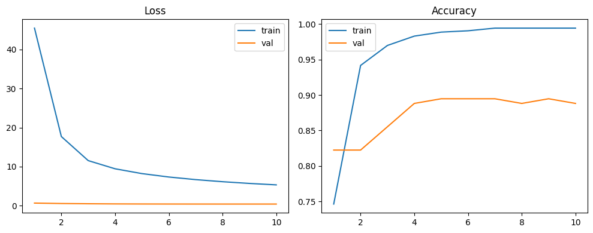
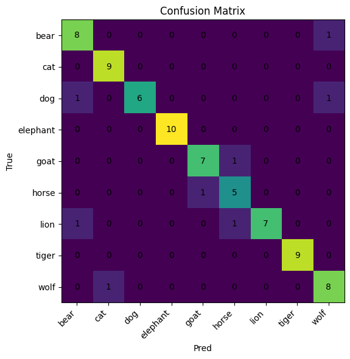
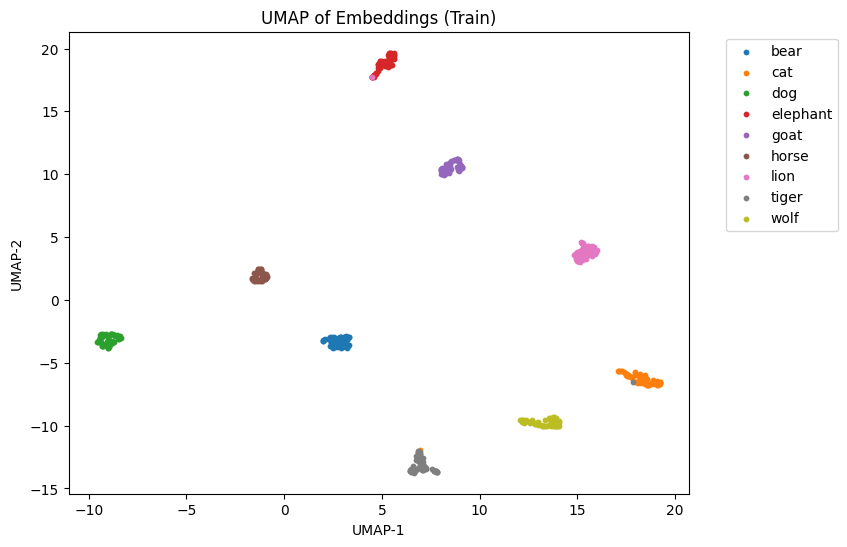
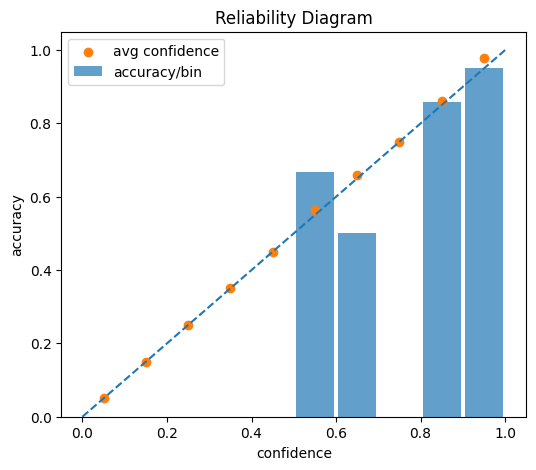

# Mammal Image Classifier

**Nine-class mammal image classification with MobileNetV2, prototype-based center loss and calibrated confidence.**
Undergraduate graduation project by Sheng-Wei Lu (呂聖韡), Department of Electrical Engineering, Yuan Ze University.


[English](#overview) | [中文](#中文說明)

---

## Overview

The system classifies photos into nine mammal classes: **bear, cat, dog, elephant, goat, horse, lion, tiger, wolf**.
Besides accuracy, the project looks at two questions that a plain classifier usually ignores:

1. **Is the feature space well structured?** A 128-d embedding is trained with an extra *prototype (center) loss* that pulls every sample towards its class centre, and the result is inspected with UMAP.
2. **Can the confidence be trusted?** Output probabilities are calibrated with *logit adjustment + temperature scaling* and evaluated with the Expected Calibration Error (ECE) and a reliability diagram.

The complete, executed pipeline is in [`notebooks/mammals_full_pipeline.ipynb`](notebooks/mammals_full_pipeline.ipynb) (Google Colab).
[`src/`](src) contains the same pipeline refactored into modules, with [`train.py`](train.py) / [`predict.py`](predict.py) as entry points.

## Method

| Stage | What is done | Key settings |
|---|---|---|
| Data | Kaggle *Mammals classification* dataset, downloaded with KaggleHub; only the 9 target folders are kept | 827 images |
| Cleaning | pHash near-duplicate removal (per class), minimum-resolution filter, Laplacian-variance blur filter | Hamming distance ≤ 6, shorter side ≥ 160 px, variance ≥ 60 |
| Split | Stratified train / val / test (10 % test, then 22.22 % of the rest as val) | seed 1337 |
| Input pipeline | `image_dataset_from_directory` → `cache()` → `prefetch()` | 224 × 224, batch 32 |
| Model | ImageNet MobileNetV2 (frozen) → GAP → Dense(128) + BatchNorm = embedding → Dense(9) logits | outputs `[logits, embedding]` |
| Loss | Cross-entropy + λ · mean ‖e − c<sub>y</sub>‖² (center loss to class prototypes) | λ = 0.5 |
| Prototypes | 9 × 128 matrix, EMA update with the batch mean of each class present | momentum 0.1 |
| Training | Custom `tf.GradientTape` loop, Adam | lr 1e-3, 10 epochs |
| Calibration | Logit adjustment `+(−log prior)` from training-set class frequencies, then temperature T fitted on validation NLL (coarse + fine grid search) | T ∈ [0.1, 5.0] |
| Evaluation | Accuracy, classification report, confusion matrix, UMAP of embeddings, nearest-to-prototype images, 10-bin ECE + reliability diagram | |
| Export | `.keras` model, float16-quantised `.tflite`, `labels.txt` | |

## Results

All numbers below are taken from the executed notebook outputs.

**Data**

| | bear | cat | dog | elephant | goat | horse | lion | tiger | wolf | total |
|---|---|---|---|---|---|---|---|---|---|---|
| Images in the 9 target folders | 95 | 99 | 97 | 97 | 85 | 67 | 94 | 96 | 97 | **827** |

After cleaning **761 / 827** images remained, split into **532 / 152 / 77** (train / val / test).

**Headline metrics**

| Metric | Value |
|---|---|
| Validation accuracy (epoch 10 / best) | 88.82 % / 89.47 % |
| **Test accuracy** (77 images) | **89.61 %** (69 / 77) |
| Macro precision / recall / F1 | 0.8988 / 0.8904 / 0.8898 |
| Weighted F1 | 0.8965 |
| Fitted temperature T | 0.89 |
| **ECE** on the test set (10 bins, after logit adjustment + temperature scaling) | **0.0394** |

**Per-class test report**

| Class | Precision | Recall | F1 | Support |
|---|---|---|---|---|
| bear | 0.8000 | 0.8889 | 0.8421 | 9 |
| cat | 0.9000 | 1.0000 | 0.9474 | 9 |
| dog | 1.0000 | 0.7500 | 0.8571 | 8 |
| elephant | 1.0000 | 1.0000 | 1.0000 | 10 |
| goat | 0.8750 | 0.8750 | 0.8750 | 8 |
| horse | 0.7143 | 0.8333 | 0.7692 | 6 |
| lion | 1.0000 | 0.7778 | 0.8750 | 9 |
| tiger | 1.0000 | 1.0000 | 1.0000 | 9 |
| wolf | 0.8000 | 0.8889 | 0.8421 | 9 |

Elephant and tiger are classified perfectly. The 8 test errors are dog → bear, dog → wolf, bear → wolf, wolf → cat, goat ↔ horse (one each way), lion → bear and lion → horse, i.e. mostly between visually similar species.

| Training curves | Confusion matrix (test) |
|---|---|
|  |  |

| UMAP of training-set embeddings | Reliability diagram (test, calibrated) |
|---|---|
|  |  |

The training loss is large because it includes the center-loss term (λ · squared distance in a 128-d space); the validation loss is cross-entropy only. On the training set the embeddings form nine compact, well-separated clusters.

**Single-image demo.** An orange-cat photo that was not in the training data was predicted as
`cat 98.90 %`, `tiger 0.96 %`, `dog 0.04 %` (calibrated probabilities).

### Notes and limitations

- The test split is small (77 images, 6–10 per class), so per-class numbers are coarse.
- Test accuracy is the arg-max of the raw logits; the ECE, reliability diagram and demo use the calibrated probabilities `softmax((logits − log prior) / T)`.
- The notebook reports ECE only after calibration; no uncalibrated baseline was computed.
- In the reliability diagram, bins without any test sample (confidence below 0.5, and 0.7–0.8) are drawn with a placeholder confidence at the bin centre, so those orange dots on the diagonal are not data. Only the 0.5–0.7 and 0.8–1.0 bins contain predictions.
- The MobileNetV2 backbone stays frozen and the final notebook uses no data augmentation.
- The UMAP plot uses training-set embeddings, so it shows how well the training data is separated, not how well the model generalises.

## Project structure

```text
mammal-image-classifier/
├── notebooks/
│   └── mammals_full_pipeline.ipynb   # final executed Colab notebook (outputs kept)
├── src/
│   ├── config.py        # hyper-parameters and paths
│   ├── data.py          # KaggleHub download, cleaning, stratified split, tf.data
│   ├── model.py         # MobileNetV2 + embedding + classifier, prototype variable
│   ├── training.py      # custom loop: CE + center loss, EMA prototypes, curves
│   ├── calibration.py   # logit adjustment, temperature search (NLL)
│   ├── evaluation.py    # report, confusion matrix, ECE, reliability diagram
│   ├── embedding.py     # embeddings, UMAP, nearest-to-prototype images
│   ├── export.py        # .keras / float16 .tflite / labels export
│   └── inference.py     # calibrated Top-k prediction
├── train.py             # end-to-end pipeline
├── predict.py           # Top-3 prediction with the exported model
├── assets/              # figures extracted from the notebook outputs
├── requirements.txt
└── LICENSE
```

## Getting started

**Option A: notebook (recommended).** Open `notebooks/mammals_full_pipeline.ipynb` in Google Colab with a GPU runtime and run all cells. The last cell asks you to upload an image for the demo.

**Option B: scripts.**

```bash
git clone https://github.com/ShengWei0528/mammal-image-classifier.git
cd mammal-image-classifier
pip install -r requirements.txt

python train.py --work-dir work          # download, clean, split, train, evaluate, export
python predict.py my_photo.jpg --export-dir work/export
```

`train.py` writes figures to `work/figures/`, the model files to `work/export/` and a `metrics.json` summary to `work/`.
The dataset is downloaded with KaggleHub; if authentication is required, `kagglehub.login()` is called. Never commit `kaggle.json`.
The scripts are a modular refactor of the notebook. The results above come from the notebook run, not from a separate run of the scripts.

## Tech stack

Python · TensorFlow / Keras (MobileNetV2, custom training loop, TFLite) · scikit-learn · UMAP · OpenCV · ImageHash · Pandas · Matplotlib · KaggleHub · Google Colab

## Context

- **Course:** Undergraduate Graduation Project (畢業專題), Department of Electrical Engineering, College of Electrical and Communication Engineering, Yuan Ze University (元智大學電機工程學系，電機通訊學院)
- **Report title:** 基於深度學習之哺乳動物影像分類系統設計與評估 (*Design and Evaluation of a Deep-Learning-Based Mammal Image Classification System*)
- **Poster title:** 基於深度學習之九類哺乳動物影像分類與信心校準系統 (*A Deep-Learning-Based Nine-Class Mammal Image Classification and Confidence Calibration System*)
- **Exhibited at:** EE Department Group B Graduation Project Exhibition (電機系乙組畢業專題展), 2nd semester of academic year 114 (spring 2026)

## Credits

- **Author:** Sheng-Wei Lu (呂聖韡)
- **Advisor:** Prof. 林柏江 (指導教授 林柏江)
- **Dataset:** [Mammals classification](https://www.kaggle.com/datasets/anirudhg15/mammals-classification) by *anirudhg15* on Kaggle, listed there as CC0: Public Domain. According to its description, the images were collected through web image search. The dataset is **not** redistributed in this repository.
- **Pre-trained weights:** MobileNetV2 ImageNet weights from `tf.keras.applications`.
- **References**
  - M. Sandler et al., "MobileNetV2: Inverted Residuals and Linear Bottlenecks," CVPR 2018.
  - Y. Wen et al., "A Discriminative Feature Learning Approach for Deep Face Recognition," ECCV 2016 (center loss).
  - C. Guo et al., "On Calibration of Modern Neural Networks," ICML 2017 (temperature scaling, ECE).

## License

Code is released under the [MIT License](LICENSE).

---

## 中文說明

**基於深度學習之哺乳動物影像分類系統設計與評估**：以 MobileNetV2 搭配類別原型（中心損失）與信心度校準，完成九類哺乳動物影像分類。本專案為呂聖韡（Sheng-Wei Lu）於元智大學電機工程學系完成的大學部畢業專題。

### 專案概述

系統可將影像分為九類哺乳動物：**熊、貓、狗、大象、山羊、馬、獅子、老虎、狼**。除了準確率，本專題也關注兩個一般分類器較少處理的問題：

1. **特徵空間是否結構良好？** 在 128 維嵌入向量上加入「原型（中心）損失」，將每個樣本拉向所屬類別的中心，並以 UMAP 觀察嵌入分布。
2. **模型信心度是否可信？** 以「Logit Adjustment＋溫度標定（Temperature Scaling）」校準輸出機率，並以期望校準誤差（ECE）與可靠度圖評估。

完整且已執行的流程請見 [`notebooks/mammals_full_pipeline.ipynb`](notebooks/mammals_full_pipeline.ipynb)（Google Colab）。[`src/`](src) 將同一流程拆成模組，入口程式為 [`train.py`](train.py) 與 [`predict.py`](predict.py)。

### 方法

| 階段 | 內容 | 主要設定 |
|---|---|---|
| 資料 | 以 KaggleHub 下載 Kaggle「Mammals classification」資料集，僅保留 9 個目標類別資料夾 | 共 827 張 |
| 資料清理 | 各類別內以 pHash 去除近似重複影像、解析度門檻過濾、Laplacian 變異數去模糊 | 漢明距離 ≤ 6、短邊 ≥ 160 px、變異數 ≥ 60 |
| 資料切分 | 分層抽樣切分訓練／驗證／測試集（先取 10% 為測試集，其餘再取 22.22% 為驗證集） | seed 1337 |
| 資料管線 | `image_dataset_from_directory` → `cache()` → `prefetch()` | 224 × 224、batch 32 |
| 模型 | ImageNet 預訓練 MobileNetV2（凍結）→ GAP → Dense(128)+BatchNorm（嵌入向量）→ Dense(9) logits | 輸出 `[logits, embedding]` |
| 損失函數 | 交叉熵＋λ · 平均 ‖e − c<sub>y</sub>‖²（與類別原型的中心損失） | λ = 0.5 |
| 類別原型 | 9 × 128 矩陣，以批次內各類別嵌入平均值做 EMA 更新 | 動量 0.1 |
| 訓練 | 自訂 `tf.GradientTape` 訓練迴圈，Adam 最佳化器 | 學習率 1e-3、10 個 epoch |
| 校準 | 依訓練集類別比例加上 `−log(prior)` 的 logit adjustment，再於驗證集以 NLL 最小化搜尋溫度 T（粗搜尋＋細搜尋） | T ∈ [0.1, 5.0] |
| 評估 | 準確率、分類報告、混淆矩陣、嵌入向量 UMAP、最接近原型之影像、10 區間 ECE 與可靠度圖 | |
| 匯出 | `.keras` 模型、float16 量化 `.tflite`、`labels.txt` | |

### 實驗結果

以下數據皆取自 notebook 的實際執行輸出。

- 9 個目標類別共 **827** 張（熊 95、貓 99、狗 97、大象 97、山羊 85、馬 67、獅子 94、老虎 96、狼 97）；清理後保留 **761** 張，切分為 **532／152／77**（訓練／驗證／測試）。
- 驗證準確率：第 10 個 epoch 為 88.82%，最佳為 89.47%。
- **測試準確率 89.61%**（77 張中答對 69 張）；Macro Precision／Recall／F1 = 0.8988／0.8904／0.8898，Weighted F1 = 0.8965。
- 溫度標定得到 T ≈ 0.89；校準後測試集 **ECE = 0.0394**（10 個信心區間）。
- 大象與老虎全部分類正確；8 個誤判為：狗→熊、狗→狼、熊→狼、狼→貓、山羊↔馬（各 1）、獅子→熊、獅子→馬，主要集中在外觀相近的物種之間。
- 單張影像推論：一張未出現在訓練集中的橘貓照片，校準後 Top-3 為 `cat 98.90%`、`tiger 0.96%`、`dog 0.04%`。

各類別指標、訓練曲線、混淆矩陣、UMAP 與可靠度圖請見上方英文段落的表格與圖片。

### 注意事項與限制

- 測試集僅 77 張（每類 6–10 張），各類別指標的解析度有限。
- 測試準確率以原始 logits 的 arg-max 計算；ECE、可靠度圖與推論示例則使用校準後機率 `softmax((logits − log prior) / T)`。
- notebook 僅計算校準後的 ECE，沒有未校準的基準值。
- 可靠度圖中沒有任何測試樣本的區間（信心度低於 0.5 以及 0.7–0.8），其平均信心點為區間中心的預設值，並非實際資料；只有 0.5–0.7 與 0.8–1.0 的區間含有預測結果。
- MobileNetV2 骨幹全程凍結，最終版 notebook 未使用資料增強。
- UMAP 使用訓練集嵌入向量，呈現的是訓練資料的可分性，而非泛化能力。
- 訓練損失包含中心損失項，因此數值遠大於僅含交叉熵的驗證損失。

### 使用方式

**方式 A：Notebook（建議）。** 在 Google Colab 開啟 `notebooks/mammals_full_pipeline.ipynb`，選擇 GPU 執行環境後執行全部儲存格；最後一格會要求上傳一張影像做推論示範。

**方式 B：Python 腳本。**

```bash
git clone https://github.com/ShengWei0528/mammal-image-classifier.git
cd mammal-image-classifier
pip install -r requirements.txt

python train.py --work-dir work          # 下載、清理、切分、訓練、評估、匯出
python predict.py my_photo.jpg --export-dir work/export
```

圖表輸出至 `work/figures/`，模型輸出至 `work/export/`，指標摘要存於 `work/metrics.json`。資料集透過 KaggleHub 下載，若需要驗證會呼叫 `kagglehub.login()`；請勿將 `kaggle.json` 提交到版本庫。
腳本是 notebook 的模組化重構；上方結果來自 notebook 的執行紀錄，並非另外以腳本重新訓練所得。

### 技術棧

Python、TensorFlow／Keras（MobileNetV2、自訂訓練迴圈、TFLite）、scikit-learn、UMAP、OpenCV、ImageHash、Pandas、Matplotlib、KaggleHub、Google Colab

### 背景

- **課程：** 畢業專題，元智大學電機通訊學院電機工程學系
- **報告題目：** 基於深度學習之哺乳動物影像分類系統設計與評估
- **海報題目：** 基於深度學習之九類哺乳動物影像分類與信心校準系統
- **展出：** 一一四─二學期電機系乙組畢業專題展

### 致謝與來源

- **作者：** 呂聖韡（Sheng-Wei Lu）
- **指導教授：** 林柏江 教授
- **資料集：** Kaggle 上 *anirudhg15* 的 [Mammals classification](https://www.kaggle.com/datasets/anirudhg15/mammals-classification)，標示授權為 CC0: Public Domain；依其說明，影像來自網路圖片搜尋。本版本庫**不**重新散布資料集。
- **預訓練權重：** `tf.keras.applications` 提供的 MobileNetV2 ImageNet 權重。
- **參考文獻：** MobileNetV2（Sandler et al., CVPR 2018）、Center Loss（Wen et al., ECCV 2016）、模型校準（Guo et al., ICML 2017）。

### 授權

程式碼採用 [MIT License](LICENSE)。
